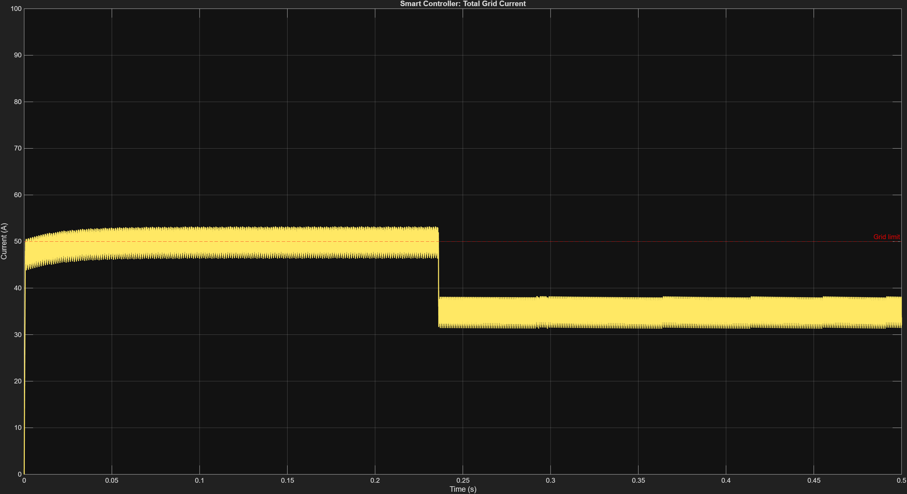
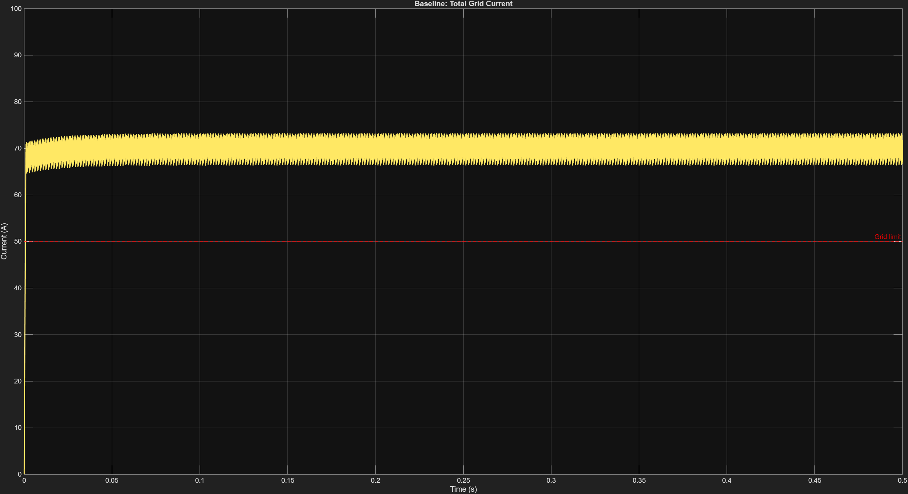
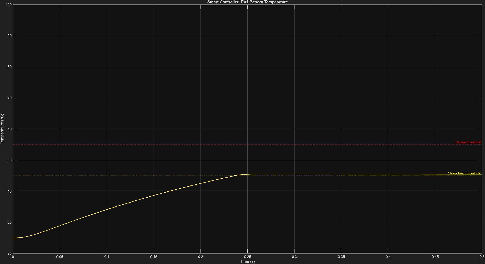
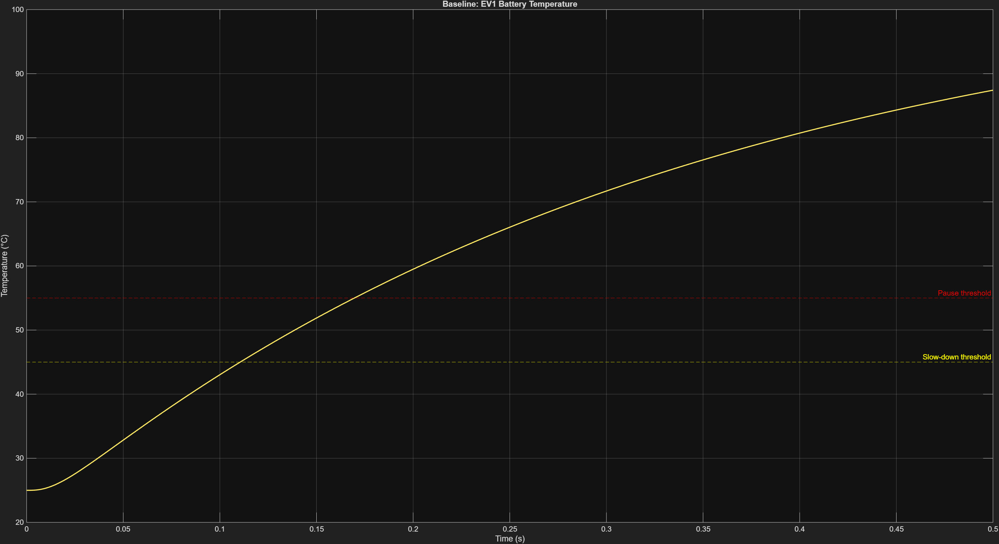
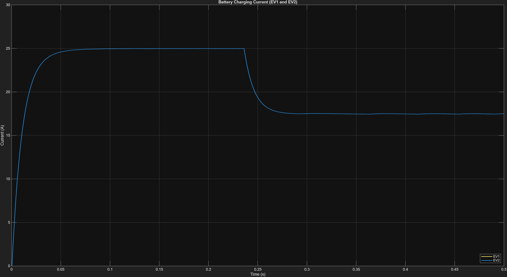
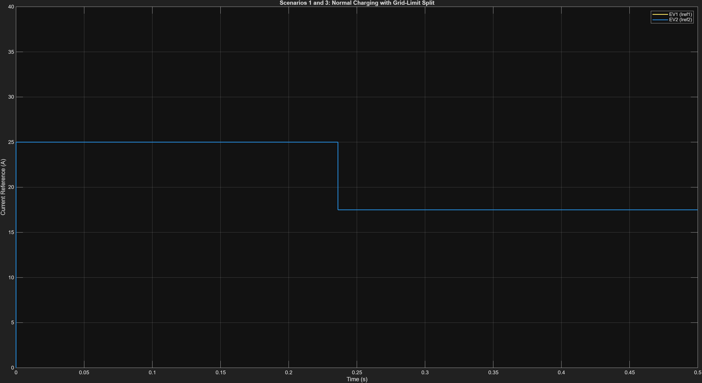
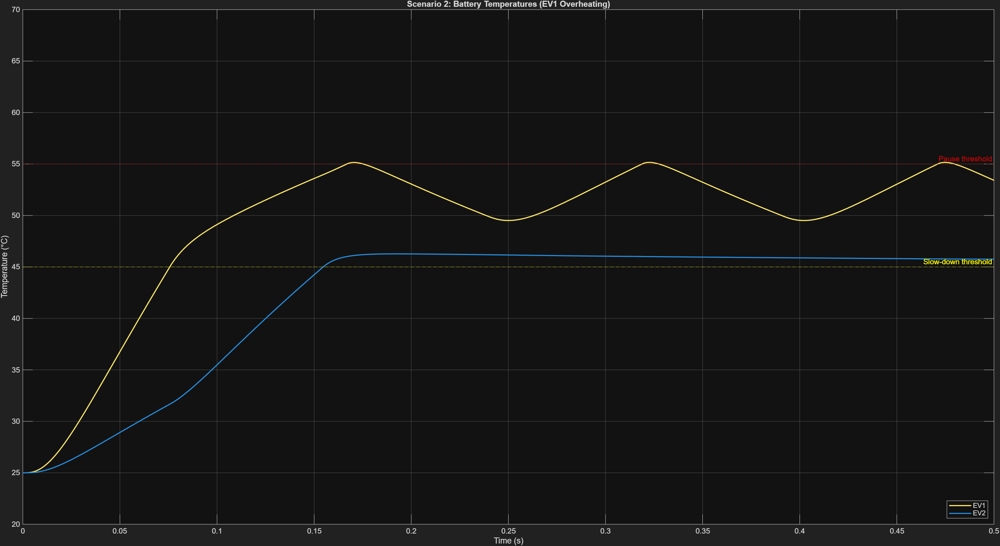
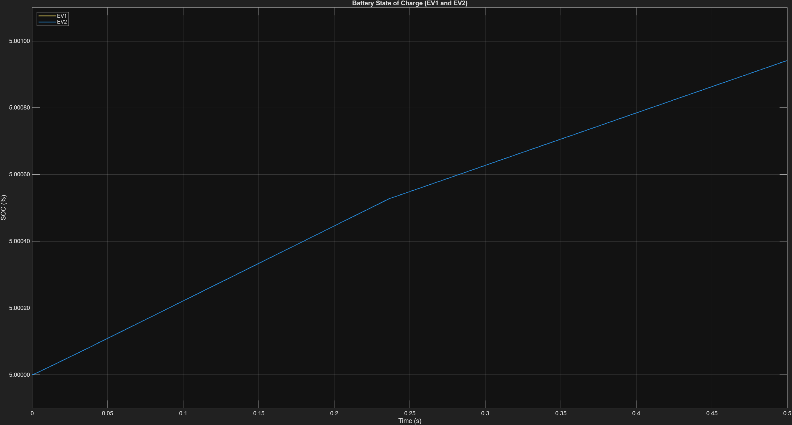
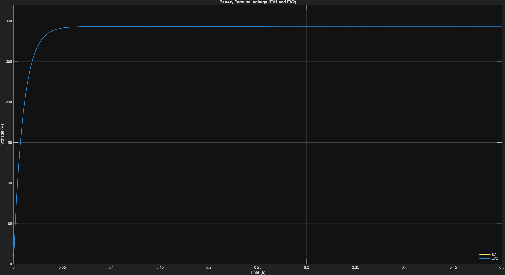

# Smart Load-Sharing EV Charging Station

### MATLAB | Simulink | Simscape Electrical | Stateflow

A simulation-based EV charging system designed to manage two electric vehicles sharing a power supply with a limited current capacity.

The project combines controlled battery charging, proportional load sharing, and temperature-based protection to improve current utilization and prevent excessive battery temperatures in simulated operating conditions.

---

## Project Objectives

- Simulate a charging station supplying two electric vehicles.
- Implement buck converters and CC-CV charging control.
- Distribute available current between two vehicles.
- Enforce a shared supply current limit of 50 A.
- Implement temperature-based charging protection using Stateflow.
- Compare controlled charging against a baseline charging strategy.

---

## System Architecture

The simulated system includes:

1. DC power supply with a shared current constraint.
2. Buck converter-based charging stages.
3. CC-CV battery charging control.
4. Proportional load-sharing controller.
5. Stateflow-based thermal protection logic.
6. Voltage, current, temperature, and state-of-charge monitoring.

---

## Key Features

### 1. Dynamic Load Sharing

The controller distributes available current between the two EV charging channels.

When one vehicle reduces its charging demand or pauses because of overheating, the available current can be reallocated to the other vehicle, subject to the shared supply limit.

### 2. Thermal Protection

The Stateflow protection logic uses temperature thresholds:

- **45°C:** Charging current is reduced.
- **55°C:** Charging is paused.
- **Hysteresis-based recovery:** Charging resumes when the temperature falls to the configured recovery threshold.

These thresholds are simulation parameters and should not be interpreted as universal battery safety limits.

### 3. Baseline Comparison

The controlled system is compared with a baseline charging strategy to examine:

- Supply current and current-limit compliance.
- Battery temperature.
- Current distribution between vehicles.
- Battery state of charge.
- Output voltage.

---

## Simulation Results

### Shared Grid Current



### Baseline Grid Current



### Smart Charging Temperature



### Baseline Temperature



### Current Distribution Between EVs



### Scenario 1 and 3 Current Split



### Scenario 2 Current Split


### Scenario 2 Temperature



### Battery State of Charge



### Voltage Monitoring



---

## Project Structure

```text
smart-ev-charging-simulink/
├── model/
│   ├── Dual_EV_Charger_final.slx
│   └── Dual_EV_Charger_baseline.slx
├── figures/
│   ├── baseline_grid_current.png
│   ├── baseline_temperature.png
│   ├── current_both_evs.png
│   ├── scenario1_3_current_split.png
│   ├── scenario2_current_split.png
│   ├── scenario2_temperature.png
│   ├── smart_grid_current.png
│   ├── smart_temperature.png
│   ├── soc_both_evs.png
│   └── voltage_both_evs.png
├── report/
│   ├── EV_Charging_Project_Report.pdf
└── README.md
```

---

## Software Requirements

- MATLAB
- Simulink
- Simscape Electrical
- Stateflow

Use a MATLAB release compatible with the model and its required toolboxes.

---

## How to Run

1. Clone or download this repository.
2. Open MATLAB.
3. Navigate to the `model` directory.
4. Open `Dual_EV_Charger_final.slx`.
5. Check that the required toolboxes are installed.
6. Run the simulation.
7. Open `Dual_EV_Charger_baseline.slx` to compare the baseline behavior.
8. Inspect the simulation outputs and figures.

Exact results may vary depending on solver settings, model parameters, and software versions.

---

## Limitations

- This is a simulation-based project, not a validated physical charging station.
- Battery thermal behavior depends on the model assumptions and parameter choices.
- Simulation results do not establish real-world battery safety or hardware performance.
- Hardware implementation would require additional protection, validation, and testing.

---

## Future Improvements

- Add a more detailed electrothermal battery model.
- Investigate adaptive current allocation.
- Evaluate performance under different supply limits and charging demands.
- Validate the controller using hardware-in-the-loop testing.

---

## Author

**Daiwik Thakare**

B.Tech — Electrical and Electronics Engineering

---

*Developed as a simulation project using MATLAB and Simulink.*
